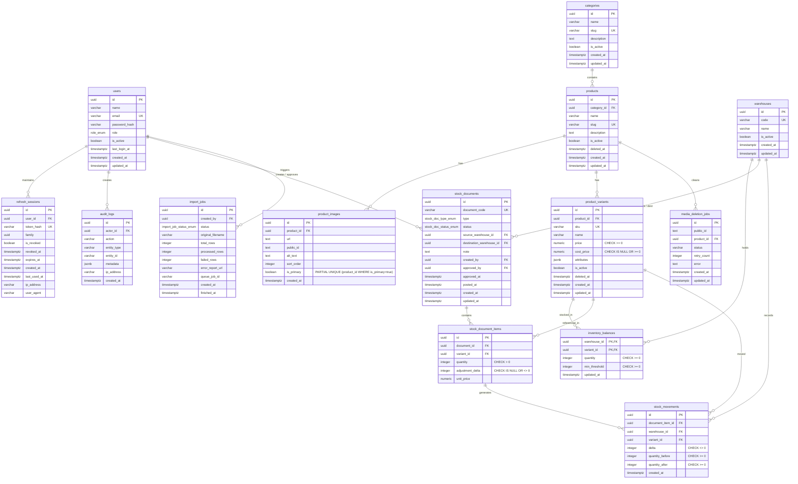

# Entity Relationship Diagram (ERD) — Cloud Stock Management

## 1. Visual Schema Diagram

---

## 2. Table Summary & Invariant Enforcements

| Table Name | Primary Key | Critical Constraints |
| :--- | :--- | :--- |
| `users` | `id` (UUID) | `email` UNIQUE |
| `refresh_sessions` | `id` (UUID) | `token_hash` UNIQUE, index on `family` |
| `categories` | `id` (UUID) | `slug` UNIQUE |
| `products` | `id` (UUID) | `slug` UNIQUE, Soft delete via `deleted_at` |
| `product_images` | `id` (UUID) | PARTIAL UNIQUE `(product_id WHERE is_primary=true)` |
| `product_variants` | `id` (UUID) | `sku` UNIQUE, `CHECK (price >= 0)`, `CHECK (cost_price IS NULL OR cost_price >= 0)`, **NO quantity column** |
| `media_deletion_jobs` | `id` (UUID) | Index on `status` |
| `warehouses` | `id` (UUID) | `code` UNIQUE |
| `inventory_balances` | `(warehouse_id, variant_id)` | `CHECK ("quantity" >= 0)`, `CHECK ("min_threshold" >= 0)` |
| `stock_documents` | `id` (UUID) | `document_code` UNIQUE, `CHECK (TRANSFER rule)` |
| `stock_document_items` | `id` (UUID) | UNIQUE `(document_id, variant_id)`, `CHECK ("quantity" > 0)` |
| `stock_movements` | `id` (UUID) | UNIQUE `(document_item_id, warehouse_id)`, `CHECK ("delta" <> 0)`, non-negative balances |
| `audit_logs` | `id` (UUID) | Indexes on `(entity_type, entity_id)`, `actor_id`, `created_at` |
| `import_jobs` | `id` (UUID) | Indexes on `created_by`, `status`, `created_at` |

